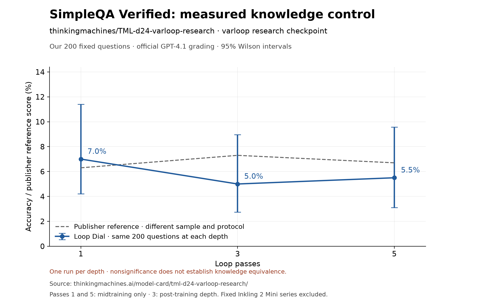

# SimpleQA Verified control

Checkpoint: **thinkingmachines/TML-d24-varloop-research, varloop research checkpoint**. The separately approved control contains **600 graded responses on the same 200 questions** at passes 1, 3 and 5.

| Passes | Correct / n | Accuracy, 95% Wilson CI (%) | Mean reasoning, bootstrap 95% CI | Median reasoning | Mean answer tokens | Incorrect / not attempted |
| --- | --- | --- | --- | --- | --- | --- |
| 1 | 14/200 | 7.0% [4.2, 11.4] | 1,577.5 [1243.1, 1944.8] | 603.5 | 23.6 | 47 / 139 |
| 3 | 10/200 | 5.0% [2.7, 9.0] | 1,033.6 [801.2, 1294.8] | 464.5 | 16.8 | 52 / 138 |
| 5 | 11/200 | 5.5% [3.1, 9.6] | 829.2 [636.3, 1056.4] | 417.0 | 16.9 | 52 / 137 |

| Paired comparison | Accuracy change pp, 95% CI | Gains / losses | Exact McNemar p | Reasoning-token change, paired 95% CI |
| --- | --- | --- | --- | --- |
| 1 → 3 passes, n=200 | -2.0 [-5.0, 0.5] | 2 / 6 | 0.2891 | -543.9 [-839.0, -271.8] |

The paired test did not resolve an accuracy difference between one and three passes. The intervals describe sampling uncertainty and do not include automated-grader error. A nonsignificant test does not prove equivalence, and no equivalence margin was specified. A 200-question subset and one run per depth cannot establish that knowledge stays flat in general. All three depth estimates and their intervals are shown rather than reduced to a flat/non-flat label.

The subset was frozen by hash ranking with seed 20261121 before generation. Prompts were the bare questions, with no tools or retrieval, temperature zero, seed 1729, concurrency 32, separate KV caches, context 16,384 and output cap 8,192. Reasoning length is visible reasoning retokenized with the checkpoint tokenizer. API counts and complete raw traces are retained. Accuracy includes incorrect answers and non-attempts in its denominator.

Grading uses the exact official SimpleQA Verified rubric and **gpt-4.1-2025-04-14**, via OpenAI Batch with judge temperature zero and a 16-token A/B/C response allowance. Only the final answer channel is sent to the judge. Identical complete judge prompts share a judgment; malformed judgments stop scoring rather than being silently counted. These execution settings are documented alongside the official source.

All 504 distinct official grading requests completed; 96 identical prompts reused a judgment. There were no inference errors. Truncations by pass are 1: 24, 3: 10, 5: 7.

The chart shows **our estimates with 95% Wilson intervals**. The gray dashed publisher curve is a reference only: its sample and protocol are not matched to our 200-question control. No publisher results are pooled into our accuracy, intervals or tests.

Sources: [official dataset and methodology](https://huggingface.co/datasets/google/simpleqa-verified), [official grader notebook](https://www.kaggle.com/code/nanliao7/simpleqa-verified-benchmark-starter-code), [model-card reference](https://thinkingmachines.ai/model-card/tml-d24-varloop-research/). [Subset and source manifest](data/knowledge/manifest.json) · [complete analysis](results/knowledge/analysis.json) · [raw official judgments](results/knowledge/grader-output.jsonl) · [run configuration](knowledge-config.json)

Reasoning-length sensitivity: among the 174 questions uncapped at both one and three passes, mean reasoning changed by -91.0 tokens (paired 95% CI [-173.1, -10.3]), or -13.6%. This descriptive subset excludes capped outputs; it is not a controlled token-budget experiment.

## Approved knowledge-control cost

The user approved a **$5 combined cap**, replacing the earlier $9 proposal. No further control runs are authorized.

| Component | USD | Basis |
| --- | --- | --- |
| HF GPU upper bound | 0.9167 | Submission through terminal observation, rounded up to a minute |
| Official grader usage cost upper bound | 0.8368 | Actual returned tokens at published Batch prices, before any caching discount |
| Combined resource-cost upper bound | 1.7535 | Under the approved $5 cap |

These are timestamp- and returned-usage-based resource estimates, not a verified invoice. The original study's HF billing-access limitation still applies. [Budget calculation](results/knowledge/budget-report.json) · [OpenAI Batch pricing](https://developers.openai.com/api/docs/guides/batch) · [approved protocol](KNOWLEDGE_PLAN.md)
