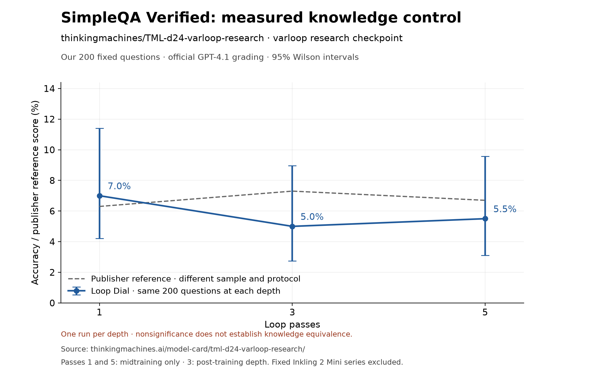

# Publication audit and additions

Checkpoint: **thinkingmachines/TML-d24-varloop-research, varloop research checkpoint**. This audit includes the subsequently approved 600-response SimpleQA control with official grading. Its incremental cap was $5.

| Item | Status | Evidence or limitation |
| --- | --- | --- |
| 1 | Added | Full results and timing definitions: FULL_RESULTS.md; per-level GPU isolation was not measured. |
| 2 | Covered and expanded | Per-level paired length changes and hard/easy interaction below. |
| 3 | Expanded | Per-run 1 vs 3 paired tests and hierarchical paired CIs below. |
| 4 | Covered and expanded | Shared/separate KV at 3 and 5, with CIs and per-correct time. |
| 5 | Complete | 200 fixed questions at passes 1/3/5, official grading, CIs and paired tests below. |
| 6 | Added | Publisher context is separate; training ratio and depth labels cite the model card. |
| 7 | Added | Level 5 scored 38/40 at three passes. Ceiling and headroom note below. |
| 8 | Not verified | HF billing endpoints return 403. Cost estimates remain separate from an actual bill. |

## Full results and level timing

[FULL_RESULTS.md](FULL_RESULTS.md) and [full-results.csv](results/publication/full-results.csv) provide accuracy with 95% CIs, reasoning lengths, and time per correct answer for every completed setting and MATH level.

Request s/correct is the sum of measured request latencies, including failed answers, divided by the number correct. Requests overlap at concurrency 32, so this is not billed GPU wall time. Batch GPU s/correct uses the measured whole-domain batch duration. Level-only GPU times are unavailable because the levels ran together; the dash means unmeasured, not zero. No GPU time is allocated to levels by token count.

The primary per-level MATH rows are:

| Domain or level | Passes | Cache | Run | Correct / n | Accuracy, 95% Wilson CI (%) | Mean / median reasoning tokens | Request s / correct | Batch GPU s / correct |
| --- | --- | --- | --- | --- | --- | --- | --- | --- |
| MATH level 1 | 1 | separate | 0 | 39/40 | 97.5% [87.1, 99.6] | 434.1 / 111.0 | 4.511 | — |
| MATH level 2 | 1 | separate | 0 | 39/40 | 97.5% [87.1, 99.6] | 569.8 / 206.0 | 6.528 | — |
| MATH level 3 | 1 | separate | 0 | 37/40 | 92.5% [80.1, 97.4] | 1,139.1 / 393.0 | 13.853 | — |
| MATH level 4 | 1 | separate | 0 | 37/40 | 92.5% [80.1, 97.4] | 1,387.2 / 419.5 | 16.330 | — |
| MATH level 5 | 1 | separate | 0 | 33/40 | 82.5% [68.1, 91.3] | 1,954.1 / 614.5 | 25.262 | — |
| MATH level 1 | 2 | separate | 0 | 40/40 | 100.0% [91.2, 100.0] | 248.2 / 110.0 | 4.099 | — |
| MATH level 2 | 2 | separate | 0 | 40/40 | 100.0% [91.2, 100.0] | 291.9 / 221.5 | 4.983 | — |
| MATH level 3 | 2 | separate | 0 | 39/40 | 97.5% [87.1, 99.6] | 940.3 / 343.0 | 15.287 | — |
| MATH level 4 | 2 | separate | 0 | 37/40 | 92.5% [80.1, 97.4] | 1,102.1 / 344.0 | 17.620 | — |
| MATH level 5 | 2 | separate | 0 | 36/40 | 90.0% [76.9, 96.0] | 1,520.3 / 533.0 | 25.393 | — |
| MATH level 1 | 3 | separate | 0 | 40/40 | 100.0% [91.2, 100.0] | 245.2 / 106.5 | 5.527 | — |
| MATH level 2 | 3 | separate | 0 | 40/40 | 100.0% [91.2, 100.0] | 261.7 / 183.5 | 6.111 | — |
| MATH level 3 | 3 | separate | 0 | 40/40 | 100.0% [91.2, 100.0] | 881.6 / 335.5 | 18.506 | — |
| MATH level 4 | 3 | separate | 0 | 40/40 | 100.0% [91.2, 100.0] | 610.1 / 361.5 | 13.362 | — |
| MATH level 5 | 3 | separate | 0 | 38/40 | 95.0% [83.5, 98.6] | 1,213.2 / 510.0 | 25.688 | — |
| MATH level 1 | 4 | separate | 0 | 40/40 | 100.0% [91.2, 100.0] | 308.4 / 101.5 | 8.035 | — |
| MATH level 2 | 4 | separate | 0 | 40/40 | 100.0% [91.2, 100.0] | 263.1 / 191.5 | 7.428 | — |
| MATH level 3 | 4 | separate | 0 | 40/40 | 100.0% [91.2, 100.0] | 750.5 / 335.0 | 19.899 | — |
| MATH level 4 | 4 | separate | 0 | 39/40 | 97.5% [87.1, 99.6] | 730.4 / 336.5 | 18.994 | — |
| MATH level 5 | 4 | separate | 0 | 36/40 | 90.0% [76.9, 96.0] | 1,526.5 / 508.5 | 40.131 | — |
| MATH level 1 | 5 | separate | 0 | 40/40 | 100.0% [91.2, 100.0] | 238.8 / 98.0 | 7.544 | — |
| MATH level 2 | 5 | separate | 0 | 40/40 | 100.0% [91.2, 100.0] | 294.9 / 193.5 | 9.818 | — |
| MATH level 3 | 5 | separate | 0 | 39/40 | 97.5% [87.1, 99.6] | 763.8 / 329.0 | 24.016 | — |
| MATH level 4 | 5 | separate | 0 | 39/40 | 97.5% [87.1, 99.6] | 887.6 / 323.5 | 25.320 | — |
| MATH level 5 | 5 | separate | 0 | 37/40 | 92.5% [80.1, 97.4] | 1,300.1 / 497.0 | 40.902 | — |
| MATH level 1 | 6 | separate | 0 | 40/40 | 100.0% [91.2, 100.0] | 255.9 / 109.5 | 9.510 | — |
| MATH level 2 | 6 | separate | 0 | 39/40 | 97.5% [87.1, 99.6] | 487.7 / 186.0 | 16.582 | — |
| MATH level 3 | 6 | separate | 0 | 40/40 | 100.0% [91.2, 100.0] | 789.1 / 300.5 | 28.684 | — |
| MATH level 4 | 6 | separate | 0 | 40/40 | 100.0% [91.2, 100.0] | 741.7 / 359.0 | 27.278 | — |
| MATH level 5 | 6 | separate | 0 | 37/40 | 92.5% [80.1, 97.4] | 1,325.9 / 443.5 | 48.191 | — |

## Reasoning reduction by MATH level

Paired change from one to three passes. Negative values mean fewer visible reasoning tokens. Each row contains the same 40 problems at both depths; intervals are paired bootstrap intervals.

| Level | Paired n | Mean token change, 95% CI | Relative change, 95% CI (%) |
| --- | --- | --- | --- |
| 1 | 40 | -188.9 [-608.8, 50.2] | -43.5% [-74.5, 27.0] |
| 2 | 40 | -308.1 [-713.6, -67.3] | -54.1% [-70.5, -22.7] |
| 3 | 40 | -257.5 [-813.9, 288.9] | -22.6% [-52.7, 34.6] |
| 4 | 40 | -777.0 [-1449.7, -266.7] | -56.0% [-72.4, -29.0] |
| 5 | 40 | -740.9 [-1364.8, -226.3] | -37.9% [-55.7, -15.5] |

Hard levels 4–5 saved more raw tokens than easy levels 1–2, but began with longer responses. The hard-minus-easy relative change is +4.1 percentage points, with a 95% CI of −34.0 to +29.4. These data do not resolve stronger proportional shortening on hard problems. Paired comparisons against one pass at every other depth are retained in the publication JSON; those additional comparisons are exploratory.

## Repeat-run CIs and paired tests at one versus three passes

The main report already contains each setting's three-run accuracy interval. The tables here add paired depth comparisons within each run and uncertainty in mean reasoning length. The MATH comparison uses the same 100 problems across all six depth/run cells. HumanEval uses the same 164.

| Domain | Run | Paired n | Accuracy change pp | Gains / losses | Exact McNemar p | Mean token change, paired 95% CI |
| --- | --- | --- | --- | --- | --- | --- |
| MATH | 0 | 100 | 6.0 | 6 / 0 | 0.0312 | -395.8 [-724.8, -90.9] |
| MATH | 1 | 100 | 5.0 | 6 / 1 | 0.1250 | -416.6 [-773.5, -97.4] |
| MATH | 2 | 100 | 5.0 | 6 / 1 | 0.1250 | -464.7 [-806.7, -155.6] |
| HumanEval | 0 | 164 | 15.2 | 28 / 3 | 4.65e-06 | -779.4 [-1117.1, -472.7] |
| HumanEval | 1 | 164 | 12.8 | 25 / 4 | 0.0001 | -652.9 [-995.9, -318.5] |
| HumanEval | 2 | 164 | 11.6 | 24 / 5 | 0.0005 | -691.9 [-1030.5, -364.3] |

| Domain | Distinct paired tasks | Mean accuracy change pp, hierarchical 95% CI | Mean token change, hierarchical paired 95% CI |
| --- | --- | --- | --- |
| MATH | 100 | 5.3 [1.0, 10.0] | -425.7 [-741.7, -131.0] |
| HumanEval | 164 | 13.2 [7.3, 19.5] | -708.1 [-1036.7, -386.5] |

The hierarchical calculation resamples both runs and problems. It does not pool repeated tasks into a larger independent sample. McNemar tests are per run; these extra repeat comparisons are exploratory. MATH run 0 was generated in a 200-problem batch, so its matched 100 examples differ in batch composition from the repeat batches.

| Domain | Passes | Distinct tasks | Run mean reasoning tokens | Overall mean, hierarchical 95% CI |
| --- | --- | --- | --- | --- |
| MATH | 1 | 100 | 1,118.2, 1,132.3, 1,139.0 | 1,129.9 [775.6, 1537.8] |
| MATH | 3 | 100 | 722.4, 715.7, 674.4 | 704.2 [477.6, 981.7] |
| HumanEval | 1 | 164 | 1,868.5, 1,871.0, 1,836.7 | 1,858.7 [1497.4, 2249.7] |
| HumanEval | 3 | 164 | 1,089.1, 1,218.1, 1,144.8 | 1,150.7 [910.9, 1432.2] |

## Shared versus separate KV cache

| Domain | Passes | Separate accuracy, 95% CI (%) | Shared accuracy, 95% CI (%) | Paired McNemar p | Shared minus separate reasoning, 95% CI | GPU s/correct, separate / shared |
| --- | --- | --- | --- | --- | --- | --- |
| MATH | 3 | 99.0% [96.4, 99.7] | 98.5% [95.7, 99.5] | 1.0000 | -50.7 [-138.5, 32.5] | 0.685 / 0.617 |
| MATH | 5 | 97.5% [94.3, 98.9] | 97.5% [94.3, 98.9] | 1.0000 | -39.3 [-154.1, 60.1] | 1.219 / 1.158 |
| HumanEval | 3 | 95.7% [91.5, 97.9] | 95.1% [90.7, 97.5] | 1.0000 | 34.2 [-112.3, 184.6] | 1.263 / 1.341 |
| HumanEval | 5 | 95.1% [90.7, 97.5] | 93.9% [89.1, 96.7] | 0.7266 | -191.3 [-378.5, -15.8] | 2.089 / 1.752 |

Cache comparisons use the same tasks. They show no measured aggregate accuracy gain for shared KV in these cells. Timing can change with the generated responses as well as the cache implementation.

## SimpleQA Verified: our measured knowledge control

Checkpoint: **thinkingmachines/TML-d24-varloop-research, varloop research checkpoint**. The separately approved control contains **600 graded responses on the same 200 questions** at passes 1, 3 and 5.

| Passes | Correct / n | Accuracy, 95% Wilson CI (%) | Mean reasoning, bootstrap 95% CI | Median reasoning | Mean answer tokens | Incorrect / not attempted |
| --- | --- | --- | --- | --- | --- | --- |
| 1 | 14/200 | 7.0% [4.2, 11.4] | 1,577.5 [1243.1, 1944.8] | 603.5 | 23.6 | 47 / 139 |
| 3 | 10/200 | 5.0% [2.7, 9.0] | 1,033.6 [801.2, 1294.8] | 464.5 | 16.8 | 52 / 138 |
| 5 | 11/200 | 5.5% [3.1, 9.6] | 829.2 [636.3, 1056.4] | 417.0 | 16.9 | 52 / 137 |

| Paired comparison | Accuracy change pp, 95% CI | Gains / losses | Exact McNemar p | Reasoning-token change, paired 95% CI |
| --- | --- | --- | --- | --- |
| 1 → 3 passes, n=200 | -2.0 [-5.0, 0.5] | 2 / 6 | 0.2891 | -543.9 [-839.0, -271.8] |

The paired test did not resolve an accuracy difference between one and three passes. The intervals describe sampling uncertainty and do not include automated-grader error. A nonsignificant test does not prove equivalence, and no equivalence margin was specified. A 200-question subset and one run per depth cannot establish that knowledge stays flat in general. All three depth estimates and their intervals are shown rather than reduced to a flat/non-flat label.

The subset was frozen by hash ranking with seed 20261121 before generation. Prompts were the bare questions, with no tools or retrieval, temperature zero, seed 1729, concurrency 32, separate KV caches, context 16,384 and output cap 8,192. Reasoning length is visible reasoning retokenized with the checkpoint tokenizer. API counts and complete raw traces are retained. Accuracy includes incorrect answers and non-attempts in its denominator.

Grading uses the exact official SimpleQA Verified rubric and **gpt-4.1-2025-04-14**, via OpenAI Batch with judge temperature zero and a 16-token A/B/C response allowance. Only the final answer channel is sent to the judge. Identical complete judge prompts share a judgment; malformed judgments stop scoring rather than being silently counted. These execution settings are documented alongside the official source.

All 504 distinct official grading requests completed; 96 identical prompts reused a judgment. There were no inference errors. Truncations by pass are 1: 24, 3: 10, 5: 7.

The chart shows **our estimates with 95% Wilson intervals**. The gray dashed publisher curve is a reference only: its sample and protocol are not matched to our 200-question control. No publisher results are pooled into our accuracy, intervals or tests.

Sources: [official dataset and methodology](https://huggingface.co/datasets/google/simpleqa-verified), [official grader notebook](https://www.kaggle.com/code/nanliao7/simpleqa-verified-benchmark-starter-code), [model-card reference](https://thinkingmachines.ai/model-card/tml-d24-varloop-research/). [Subset and source manifest](data/knowledge/manifest.json) · [complete analysis](results/knowledge/analysis.json) · [raw official judgments](results/knowledge/grader-output.jsonl) · [run configuration](knowledge-config.json)

Reasoning-length sensitivity: among the 174 questions uncapped at both one and three passes, mean reasoning changed by -91.0 tokens (paired 95% CI [-173.1, -10.3]), or -13.6%. This descriptive subset excludes capped outputs; it is not a controlled token-budget experiment.

## Model-card context and training exposure

Later midtraining sampled passes 1–5 in the ratio **1:2:6:2:1**, followed by post-training at **3 passes**. Passes 1, 2, 4, and 5 are labeled **midtraining only**; pass 3 is the post-training depth; pass 6 is **untrained**. [Thinking Machines model card, training section](https://thinkingmachines.ai/model-card/tml-d24-varloop-research/)

Our measurements:

| Loop Dial subset accuracy (%) | 1 pass | 2 passes | 3 passes | 4 passes | 5 passes | 6 passes |
| --- | --- | --- | --- | --- | --- | --- |
| MATH | 92.5% | 96.0% | 99.0% | 97.5% | 97.5% | 98.0% |
| GSM8K | 94.7% | 96.7% | 96.7% | 96.7% | 96.7% | Not run |
| HumanEval | 80.5% | 93.9% | 95.7% | 95.7% | 95.1% | Not run |
| BBH, five tasks | 73.3% | Not run | 91.7% | Not run | 95.0% | Not run |
| SimpleQA Verified | 7.0% | Not run | 5.0% | Not run | 5.5% | Not run |

Publisher measurements, reported separately:

| Publisher benchmark, score (%) | 1 pass | 2 passes | 3 passes | 4 passes | 5 passes |
| --- | --- | --- | --- | --- | --- |
| DeepSWE v1.1 | 0.7 | 28.3 | 47.4 | 46.9 | 48.2 |
| HLE (text only) | 10.5 | 20.0 | 24.9 | 25.4 | 25.9 |
| GPQA Diamond | 69.6 | 79.2 | 84.2 | 81.9 | 83.1 |
| SimpleQA Verified | 6.3 | 6.5 | 7.3 | 6.8 | 6.7 |
| AA-Omniscience v1.1 (Public) | 15.5 | 16.3 | 18.4 | 18.0 | 17.4 |

Source: [thinkingmachines/TML-d24-varloop-research model card](https://thinkingmachines.ai/model-card/tml-d24-varloop-research/). The two tables are not combined, averaged, or treated as matched evaluations. The card does not report our GSM8K, MATH-500 subset, HumanEval, or five-task BBH protocol. Its separate fixed Inkling 2 Mini series is excluded from this table. The SGLang cookbook sanity comparison remains a separate reference in the main report.

## Ceiling and level-5 headroom

| Passes | Level-5 correct / n | Accuracy, 95% Wilson CI (%) |
| --- | --- | --- |
| 1 | 33/40 | 82.5% [68.1, 91.3] |
| 2 | 36/40 | 90.0% [76.9, 96.0] |
| 3 | 38/40 | 95.0% [83.5, 98.6] |
| 4 | 36/40 | 90.0% [76.9, 96.0] |
| 5 | 37/40 | 92.5% [80.1, 97.4] |
| 6 | 37/40 | 92.5% [80.1, 97.4] |

At three passes, levels 1–4 each scored 40/40; level 5 scored **38/40, or 95.0% (95% Wilson CI 83.5%–98.6%)**. Level 5 has observed benchmark headroom, but only two failures on 40 questions. Recovering both would add at most one percentage point to this 200-question overall score. The interval is broad, so the study cannot precisely locate a capability ceiling or establish that more depth would recover those failures.

## Actual HF Jobs bill: access still unavailable

The authenticated Jobs-usage, usage-v2, and credits endpoints return **HTTP 403** on the publication recheck. No invoice or exact Jobs charge has been verified. [Access-check record](results/full/billing-access-check.json)

The HF timestamp-based upper bound remains **$4.629133**, and the combined HF plus Modal upper bound remains **$4.786994**. These are estimates, not the actual bill. Account balances and billing identifiers are omitted from this public export.

## Approved knowledge-control cost

The user approved a **$5 combined cap**, replacing the earlier $9 proposal. No further control runs are authorized.

| Component | USD | Basis |
| --- | --- | --- |
| HF GPU upper bound | 0.9167 | Submission through terminal observation, rounded up to a minute |
| Official grader usage cost upper bound | 0.8368 | Actual returned tokens at published Batch prices, before any caching discount |
| Combined resource-cost upper bound | 1.7535 | Under the approved $5 cap |

These are timestamp- and returned-usage-based resource estimates, not a verified invoice. The original study's HF billing-access limitation still applies. [Budget calculation](results/knowledge/budget-report.json) · [OpenAI Batch pricing](https://developers.openai.com/api/docs/guides/batch) · [approved protocol](KNOWLEDGE_PLAN.md)
