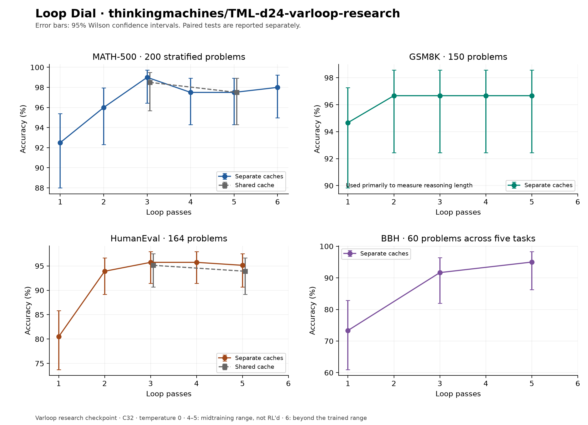
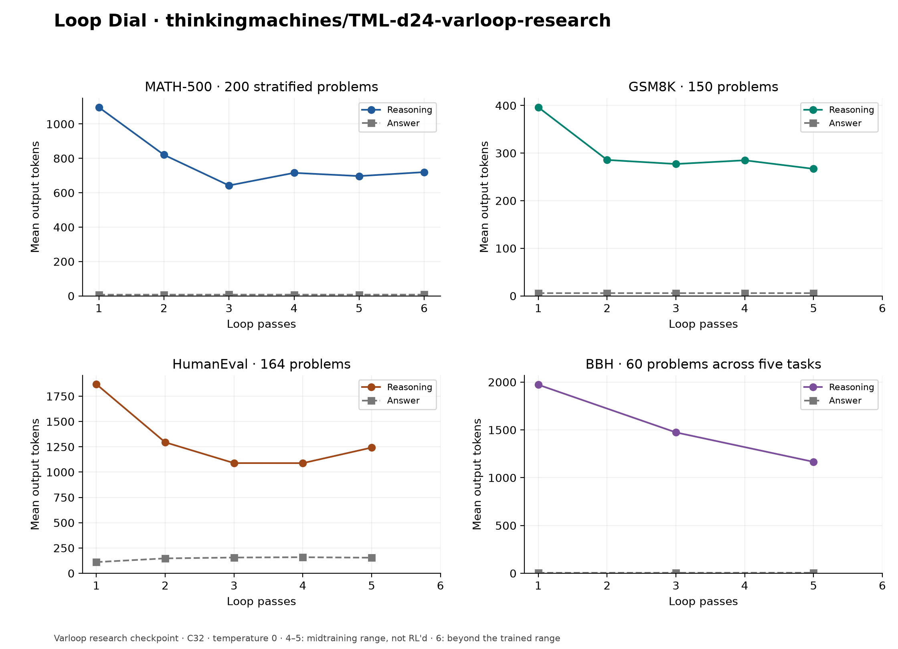
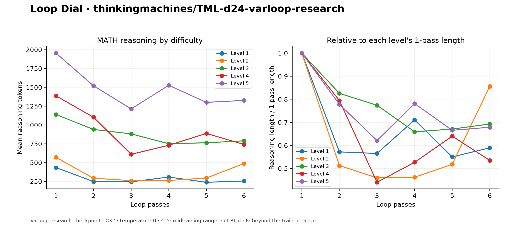
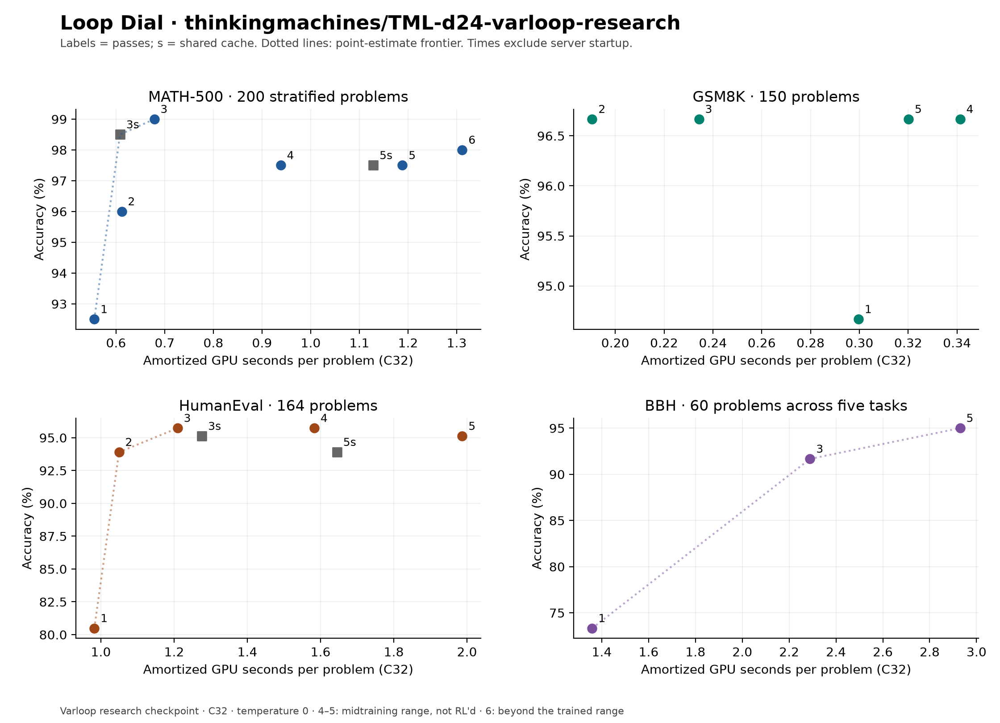
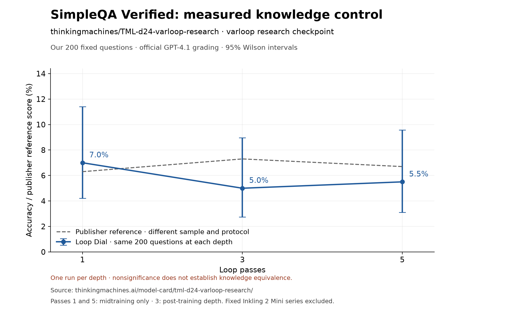

# Loop Dial — full study

**Checkpoint: thinkingmachines/TML-d24-varloop-research (varloop research checkpoint). These are not shipped Inkling 2 Mini results.**

<!-- publication-notice -->
**Knowledge control complete:** 600 SimpleQA Verified outputs on 200 fixed questions at passes 1/3/5 were graded with the official rubric and GPT-4.1 snapshot under the approved $5 cap. [Control results](KNOWLEDGE_REPORT.md). The actual HF bill remains unverified because billing access returns 403.
<!-- /publication-notice -->

Approved matrix complete: 4,734/4,734 authorized responses saved and 4,734 scored. The separately approved 600-response SimpleQA control is reported below. No further inference is authorized.

## Findings

<!-- knowledge-finding -->
**Knowledge control:** On the same 200 SimpleQA Verified questions, official grading gave 1 pass: 7.0% (95% CI [4.2, 11.4]); 3 passes: 5.0% (95% CI [2.7, 9.0]); 5 passes: 5.5% (95% CI [3.1, 9.6]). The paired one-to-three-pass accuracy change was -2.0 percentage points (95% CI [-5.0, 0.5]), exact McNemar p = 0.2891. No equivalence margin was specified; these data do not establish that knowledge stays flat. [Full control results](KNOWLEDGE_REPORT.md).
<!-- /knowledge-finding -->

On the original math, code and reasoning subsets, most of the measured benefit arrived by **2–3 passes**. MATH accuracy rose from 92.5% at one pass to 99.0% at three (95% Wilson CI 96.4%–99.7%), then scored 97.5%, 97.5%, and 98.0% at four, five, and six. The three paired comparisons against three passes all had Holm-adjusted McNemar p = 0.75. This sample provides no demonstrated accuracy gain beyond three; its ceiling limits resolution. HumanEval rose from 80.5% at one pass to 95.7% at three, remained 95.7% at four, and scored 95.1% at five. Its small higher-depth differences are comparable to observed repeat variation.

**More depth reduced written reasoning from one to three passes:** mean reasoning tokens fell 41.4% on MATH, 41.7% on HumanEval, 30.1% on GSM8K, and 25.3% on the selected BBH tasks. All four paired 95% intervals exclude zero. On problems correct in both settings, MATH and HumanEval reasoning still fell 27.8% and 20.4%, respectively, so avoiding token-limit failures explains only part of the reduction. Further passes did not continue lowering the MATH or HumanEval means: at five versus three, they were 8.5% and 14.1% higher. These latter estimates have substantial uncertainty and include occasional repetitive failures.

**Shorter text did not consistently mean faster answers.** One→three passes increased MATH batch time by 22.2% and HumanEval by 23.2%, while GSM8K batch time fell 21.8%. These finite C32 batches include response-length and tail effects. MATH GPU seconds per correct answer rose from 0.685 at three passes to 1.338 at six, nearly doubling. The compute-matched analyses are observational: neither a fixed reasoning budget nor a fixed GPU budget was imposed in additional inference controls.

BBH improved from 55/60 at three passes to 57/60 at five, with three gains and one loss (paired McNemar p = 0.625). Those changed outcomes all concern Dyck bracket completion. All 48 problems in the other four BBH tasks were correct at both depths. This is limited evidence for further gains on a small task mix.

Hard MATH items saved more tokens in absolute terms from one→three passes: the hard-minus-easy difference in reductions was 510 tokens per problem (95% CI 20–1,022). Their starting responses were longer. **Stronger proportional shortening on hard problems was not resolved:** hard-minus-easy relative length change was +4.1 percentage points (95% CI −34.0 to +29.4). Per-level curves vary rather than following a uniform difficulty trend.

Three-run accuracy ranges were 0–1.0 percentage points on the matched MATH subset and 1.83 points on HumanEval. Equal aggregate accuracy could conceal changed answers: one-pass MATH scored 93% in all three runs, but four task outcomes flipped against run 0 in each repeat. Exact full-text agreement was only 50%–73% across the repeated settings. The noise estimate is therefore coarse and depends on batch composition. Shared cache produced no higher aggregate accuracy in the measured cells; observed timing effects varied by domain.

Passes 4–5 are **midtraining range, not RL'd**; six is **beyond the trained range**. The checkpoint was RL-trained at three passes. The findings concern these fixed subsets, greedy decoding, the 8,192-token cap, and this runtime. They do not establish a general depth limit or directly measure hidden reasoning.

## Main curve

| Domain | Passes | Correct / scored | Accuracy (95% Wilson CI) | Literal match | Mean reasoning / answer | Median reasoning / answer |
| --- | --- | --- | --- | --- | --- | --- |
| MATH | 1 | 185/200 | 92.5% [88.0, 95.4] | 74.5% | 1,096.9 / 7.1 | 320.0 / 5.0 |
| MATH | 2 | 192/200 | 96.0% [92.3, 98.0] | 77.0% | 820.6 / 7.3 | 278.5 / 5.0 |
| MATH | 3 | 198/200 | 99.0% [96.4, 99.7] | 81.5% | 642.4 / 7.4 | 269.0 / 5.0 |
| MATH | 4 | 195/200 | 97.5% [94.3, 98.9] | 79.0% | 715.8 / 7.3 | 279.5 / 5.0 |
| MATH | 5 | 195/200 | 97.5% [94.3, 98.9] | 79.5% | 697.1 / 7.3 | 276.0 / 5.0 |
| MATH | 6 | 196/200 | 98.0% [95.0, 99.2] | 80.5% | 720.1 / 7.4 | 278.0 / 5.0 |
| GSM8K | 1 | 142/150 | 94.7% [89.8, 97.3] | 46.0% | 396.3 / 5.8 | 222.5 / 6.0 |
| GSM8K | 2 | 145/150 | 96.7% [92.4, 98.6] | 45.3% | 285.7 / 5.9 | 195.0 / 6.0 |
| GSM8K | 3 | 145/150 | 96.7% [92.4, 98.6] | 46.7% | 277.1 / 5.8 | 178.5 / 6.0 |
| GSM8K | 4 | 145/150 | 96.7% [92.4, 98.6] | 46.7% | 284.9 / 5.8 | 181.0 / 6.0 |
| GSM8K | 5 | 145/150 | 96.7% [92.4, 98.6] | 49.3% | 266.9 / 5.8 | 184.0 / 5.0 |
| HumanEval | 1 | 132/164 | 80.5% [73.8, 85.8] | — | 1,868.5 / 110.7 | 731.5 / 90.5 |
| HumanEval | 2 | 154/164 | 93.9% [89.1, 96.7] | — | 1,294.5 / 147.2 | 675.0 / 130.0 |
| HumanEval | 3 | 157/164 | 95.7% [91.5, 97.9] | — | 1,089.1 / 155.7 | 566.5 / 138.0 |
| HumanEval | 4 | 157/164 | 95.7% [91.5, 97.9] | — | 1,088.6 / 158.7 | 595.5 / 133.5 |
| HumanEval | 5 | 156/164 | 95.1% [90.7, 97.5] | — | 1,242.3 / 153.9 | 637.0 / 133.5 |
| BBH | 1 | 44/60 | 73.3% [61.0, 82.9] | 38.3% | 1,972.3 / 4.4 | 918.0 / 5.0 |
| BBH | 3 | 55/60 | 91.7% [81.9, 96.4] | 41.7% | 1,473.7 / 4.8 | 648.5 / 5.0 |
| BBH | 5 | 57/60 | 95.0% [86.3, 98.3] | 41.7% | 1,165.7 / 5.0 | 607.5 / 5.0 |

Passes 4–5 are **midtraining range, not RL'd**. Pass 6 is **beyond the trained range** and was measured only on MATH in the full study. Main results are the original run with separate caches; repeats are reported separately. MATH uses 40 problems per level, so its summary weights levels equally. GSM8K is primarily a length measurement.

Reasoning and answer columns count independently re-tokenized visible text. API reasoning counts usually differ by three tokens; all originals are retained. Using API reasoning counts gives one→three reductions of 41.3% MATH, 41.6% HumanEval, 29.8% GSM8K, and 25.2% BBH. Re-tokenization can occasionally exceed the generation cap by a token; these columns measure visible text length. See METHODS.md and the token audit.

## Does looping reduce written reasoning?

| Domain, 1 → 3 | Paired n | Δ reasoning tokens (95% CI) | Relative change (95% CI) | Δ accuracy pp | McNemar p |
| --- | --- | --- | --- | --- | --- |
| GSM8K | 150 | -119.2 [-240.9, -37.6] | -30.1% [-45.9, -12.1] | 2.0 | 0.2500 |
| MATH | 200 | -454.5 [-692.2, -245.8] | -41.4% [-53.6, -26.7] | 6.5 | 0.0002 |
| HumanEval | 164 | -779.4 [-1117.1, -472.7] | -41.7% [-52.3, -29.2] | 15.2 | 4.65e-06 |
| BBH | 60 | -498.6 [-949.2, -35.1] | -25.3% [-43.1, -2.0] | 18.3 | 0.0010 |

To check whether shortening merely reflects fewer token-limit failures, here is the same comparison restricted to problems answered correctly in both settings:

| Domain, 1 → 3 | Both-correct n | Mean reasoning 1 / 3 | Δ tokens (paired 95% CI) |
| --- | --- | --- | --- |
| GSM8K | 142 | 334.4 / 261.4 | -73.0 [-125.9, -28.8] |
| MATH | 185 | 624.0 / 450.4 | -173.6 [-288.5, -67.2] |
| HumanEval | 129 | 916.8 / 730.1 | -186.7 [-362.2, -13.8] |
| BBH | 44 | 766.7 / 493.0 | -273.7 [-348.3, -204.5] |

This is a descriptive sensitivity analysis selected by outcomes; the full-pair result remains primary. Nontruncated-pair sensitivity results are also retained in analysis.json. Intervals are paired problem-bootstrap intervals. Shorter visible text is evidence of output compression, not direct evidence about the content or faithfulness of hidden computation.

## Where does extra depth stop helping?

| MATH comparison | Δ accuracy pp (paired 95% CI) | Gains / losses | Exact McNemar p | Holm p | Δ reasoning tokens (paired 95% CI) |
| --- | --- | --- | --- | --- | --- |
| 3 → 4 | -1.5 [-3.5, 0.0] | 0 / 3 | 0.2500 | 0.7500 | 73.4 [-46.6, 210.3] |
| 3 → 5 | -1.5 [-3.5, 0.0] | 0 / 3 | 0.2500 | 0.7500 | 54.7 [-50.0, 162.6] |
| 3 → 6 | -1.0 [-2.5, 0.0] | 0 / 2 | 0.5000 | 0.7500 | 77.7 [-30.5, 199.2] |

Accuracy-difference intervals use a percentile bootstrap and can have a zero boundary when no gain was observed; exact McNemar tests govern accuracy comparisons. These three MATH comparisons form the primary Holm-corrected family. All adjacent, 1→3, and shared-cache paired results, including token-change intervals, are in [analysis.json](results/full/analysis.json). A nonsignificant result does not establish equality, particularly near the accuracy ceiling.

## Difficulty and reasoning length

Mean reasoning tokens by level:

| MATH level | Pass 1 | Pass 2 | Pass 3 | Pass 4 | Pass 5 | Pass 6 |
| --- | --- | --- | --- | --- | --- | --- |
| 1 | 434.1 | 248.2 | 245.2 | 308.4 | 238.8 | 255.9 |
| 2 | 569.8 | 291.9 | 261.7 | 263.1 | 294.9 | 487.7 |
| 3 | 1,139.1 | 940.3 | 881.6 | 750.5 | 763.8 | 789.1 |
| 4 | 1,387.2 | 1,102.1 | 610.1 | 730.4 | 887.6 | 741.7 |
| 5 | 1,954.1 | 1,520.3 | 1,213.2 | 1,526.5 | 1,300.1 | 1,325.9 |

| Pass comparison | Hard minus easy absolute token change (95% CI) | Hard minus easy relative change pp (95% CI) |
| --- | --- | --- |
| 1 → 3 | -510.4 [-1021.8, -20.1] | 4.1 [-34.0, 29.4] |
| 3 → 4 | 184.5 [-60.9, 495.4] | 11.0 [-20.9, 52.2] |
| 3 → 5 | 168.8 [-20.7, 411.3] | 14.7 [-13.6, 46.2] |
| 3 → 6 | 3.8 [-251.5, 206.3] | -33.3 [-128.6, 19.9] |

Easy means levels 1–2; hard means levels 4–5. Negative hard-minus-easy relative change means more proportional shortening on hard problems. All per-level paired absolute and relative confidence intervals are saved in analysis.json.

## Hard-reasoning task breakdown

| BBH task | 1 pass | 3 passes | 5 passes |
| --- | --- | --- | --- |
| boolean_expressions | 10/12 | 12/12 | 12/12 |
| dyck_languages | 2/12 | 7/12 | 9/12 |
| logical_deduction_seven_objects | 10/12 | 12/12 | 12/12 |
| multistep_arithmetic_two | 12/12 | 12/12 | 12/12 |
| tracking_shuffled_objects_seven_objects | 10/12 | 12/12 | 12/12 |

These small task cells help identify which task types drive the pooled BBH curve. They do not represent the full BBH suite or GPQA.

## Shared versus separate caches

| Domain | Passes | Separate / shared accuracy | Δ accuracy pp | Gains / losses; p | Separate / shared reasoning | Separate / shared tokens/s |
| --- | --- | --- | --- | --- | --- | --- |
| MATH | 3 | 99.0% / 98.5% | -0.5 | 0 / 1; 1.0000 | 642.4 / 591.7 | 968 / 997 |
| MATH | 5 | 97.5% / 97.5% | 0.0 | 1 / 1; 1.0000 | 697.1 / 657.7 | 598 / 595 |
| HumanEval | 3 | 95.7% / 95.1% | -0.6 | 3 / 4; 1.0000 | 1,089.1 / 1,123.3 | 1,035 / 1,019 |
| HumanEval | 5 | 95.1% / 93.9% | -1.2 | 3 / 5; 0.7266 | 1,242.3 / 1,051.0 | 706 / 733 |

Cache comparisons use the same problems and a fresh server. Their McNemar tests are exploratory. Observed memory includes reserved pools; a smaller reservation is not a measurement of intrinsic per-request memory requirements.

## Speed and cost per correct answer

| Domain | Passes | Tokens/s | Batch seconds | Mean request s | Effective decode ms/token | GPU s/correct | Inference $/correct | Tokens/correct |
| --- | --- | --- | --- | --- | --- | --- | --- | --- |
| MATH | 1 | 2,000 | 111.1 | 11.9 | 10.90 | 0.600 | 0.000459 | 1,201 |
| MATH | 2 | 1,365 | 122.3 | 12.6 | 15.67 | 0.637 | 0.000487 | 869 |
| MATH | 3 | 968 | 135.7 | 13.6 | 21.22 | 0.685 | 0.000524 | 663 |
| MATH | 4 | 778 | 187.7 | 18.0 | 25.53 | 0.962 | 0.000735 | 749 |
| MATH | 5 | 598 | 237.7 | 20.7 | 30.42 | 1.219 | 0.000931 | 730 |
| MATH | 6 | 560 | 262.3 | 25.2 | 35.58 | 1.338 | 0.001022 | 749 |
| GSM8K | 1 | 1,365 | 44.9 | 4.3 | 10.89 | 0.317 | 0.000242 | 432 |
| GSM8K | 2 | 1,567 | 28.6 | 5.0 | 16.01 | 0.197 | 0.000151 | 309 |
| GSM8K | 3 | 1,238 | 35.1 | 6.5 | 21.81 | 0.242 | 0.000185 | 300 |
| GSM8K | 4 | 872 | 51.2 | 7.8 | 26.05 | 0.353 | 0.000270 | 308 |
| GSM8K | 5 | 874 | 48.0 | 9.0 | 31.31 | 0.331 | 0.000253 | 289 |
| HumanEval | 1 | 2,022 | 161.0 | 24.0 | 12.17 | 1.220 | 0.000932 | 2,467 |
| HumanEval | 2 | 1,380 | 172.1 | 24.7 | 17.51 | 1.118 | 0.000854 | 1,543 |
| HumanEval | 3 | 1,035 | 198.3 | 29.7 | 23.74 | 1.263 | 0.000965 | 1,308 |
| HumanEval | 4 | 792 | 259.6 | 35.1 | 28.59 | 1.654 | 0.001263 | 1,310 |
| HumanEval | 5 | 706 | 325.9 | 48.1 | 34.76 | 2.089 | 0.001596 | 1,475 |
| BBH | 1 | 1,459 | 81.5 | 19.4 | 10.41 | 1.853 | 0.001416 | 2,704 |
| BBH | 3 | 649 | 137.3 | 26.7 | 19.96 | 2.497 | 0.001908 | 1,620 |
| BBH | 5 | 402 | 175.8 | 29.8 | 28.75 | 3.084 | 0.002356 | 1,240 |

GPU seconds/correct are domain-batch wall seconds divided by correct count. Per-condition dollars use $2.75/GPU-hour and exclude server loading and CPU grading. Request seconds include time while other requests run at C32; batch seconds/problem are amortized throughput costs, not interactive latency. Effective decode ms/token is a streaming first-to-last-text proxy. Exact means, medians, accuracy/second, total tokens, truncations, memory peaks, and shared/repeat timing are in [metrics.csv](results/full/metrics.csv).

Peak sampled GPU memory across the study was **87,209 MiB (85.17 GiB)** on the 96 GB RTX PRO 6000. This BF16 runtime measurement includes reserved pools.

## Repeat noise

| Domain | Passes | Shared n | Run accuracies | Range / SD pp | Hierarchical accuracy 95% CI | Score flips vs run 0 | Exact output agreement vs run 0 |
| --- | --- | --- | --- | --- | --- | --- | --- |
| MATH | 1 | 100 | 93.0%, 93.0%, 93.0% | 0.00 / 0.00 | [88.0, 97.0] | [4, 4] | 59.0%, 72.0% |
| MATH | 3 | 100 | 99.0%, 98.0%, 98.0% | 1.00 / 0.58 | [95.7, 100.0] | [1, 1] | 50.0%, 52.0% |
| HumanEval | 1 | 164 | 80.5%, 81.1%, 82.3% | 1.83 / 0.93 | [75.4, 87.0] | [9, 9] | 68.9%, 73.2% |
| HumanEval | 3 | 164 | 95.7%, 93.9%, 93.9% | 1.83 / 1.06 | [90.7, 97.8] | [5, 3] | 68.9%, 70.7% |

Each cell has three runs. MATH run 0 is restricted to the same nested 100-problem subset as repeats; HumanEval uses all 164. The range and SD describe only these three observations. Hierarchical run/problem CIs are saved in analysis.json. Repeated tasks are never counted as independent benchmark examples.

## Observational compute matching

Whole-cohort tradeoffs, using all the same problems and measured batch time:

| Domain | Passes | Batch seconds, lower / higher | Δ GPU wall time | Δ reasoning length | Δ accuracy pp | Within 10% wall budget |
| --- | --- | --- | --- | --- | --- | --- |
| MATH | 1 → 3 | 111.1 / 135.7 | 22.2% | -41.4% | 6.5 | False |
| MATH | 2 → 3 | 122.3 / 135.7 | 11.0% | -21.7% | 3.0 | False |
| GSM8K | 1 → 3 | 44.9 / 35.1 | -21.8% | -30.1% | 2.0 | False |
| HumanEval | 1 → 3 | 161.0 / 198.3 | 23.2% | -41.7% | 15.2 | False |
| BBH | 1 → 3 | 81.5 / 137.3 | 68.4% | -25.3% | 18.3 | False |

These observed timings were not held fixed by an explicit compute-budget control. The full pass-pair table is retained, including pairs with similar realized budgets. The separate length-selected proxy analysis follows.

| Domain | Pass comparison | Matched n | Δ accuracy pp | Δ reasoning tokens |
| --- | --- | --- | --- | --- |
| MATH | 1 → 3 | 6 | 16.7 | -943.0 |
| MATH | 1 → 5 | 3 | 0.0 | -1,715.0 |
| MATH | 3 → 5 | 9 | 0.0 | -486.4 |
| MATH | 3 → 6 | 3 | 0.0 | -349.7 |
| GSM8K | 1 → 3 | 8 | 0.0 | -273.4 |
| GSM8K | 1 → 5 | 6 | 0.0 | -557.2 |
| GSM8K | 3 → 5 | 10 | 0.0 | -131.4 |
| HumanEval | 1 → 3 | 13 | 15.4 | -1,007.5 |
| HumanEval | 1 → 5 | 6 | 33.3 | -2,782.7 |
| HumanEval | 3 → 5 | 13 | 0.0 | -215.4 |
| BBH | 1 → 3 | 5 | 40.0 | -1,912.6 |
| BBH | 1 → 5 | 1 | 100.0 | -5,424.0 |
| BBH | 3 → 5 | 4 | 0.0 | -177.0 |

Observational same-problem pairs with fewer written reasoning tokens at higher depth and completion_tokens*(passes+1) within 5/10/20%. The proxy counts repeated transformer layers (12 outer + 12 per pass); it excludes prefill, KV memory, and scheduling. Selection uses realized output length, so these are descriptive subsets, not causal compute-controlled experiments. Whole-cohort batch tradeoffs are also retained for every observed main-run pass pair, without selecting individual problems by outcome; a within-10%-wall-time flag marks naturally similar observed batch budgets, not a controlled budget intervention.

The table uses the 10% band; the 5%/20% sensitivity subsets and IDs are retained in analysis.json. It cannot answer a causal comparison of fixed reasoning budgets. No additional generations were run for this analysis.

## Pilot re-score and prior result

The saved pilot scores 50/50 at passes 1, 3, and 6 under numeric equivalence, each with a Wilson 95% CI of 92.9%–100%. Literal match scores are 24/50, 24/50, and 25/50. The legacy reference grader gave 44/50, 44/50, and 47/50. See [PILOT_RESCORE.md](PILOT_RESCORE.md).

The [SGLang cookbook](https://docs.sglang.io/cookbook/autoregressive/ThinkingMachines/Inkling-2-Mini) reports GSM8K 84.0% at one pass, 88.5% at three, and 90.0% at three with shared cache. The pilot's legacy 1/3-pass intervals (76.2%–94.4%) cover the corresponding figures, but that is only a rough 50-example check. The new numeric metric differs, and the cookbook's loop-options paragraph does not pin its model revision, subset, or prompt, so this is not an exact reproduction. The [official release](https://thinkingmachines.ai/news/inkling-2-mini/) already studies looping and shorter reasoning; this study adds this fixed multi-domain matrix, timing, cache and repeat measurements.

Full-subset legacy-reference sanity check (secondary, does not replace numeric-equivalence grading):

| Full GSM8K subset | Legacy reference score | 95% Wilson CI | Cookbook value inside CI |
| --- | --- | --- | --- |
| 1 | 133/150 (88.7%) | [82.6, 92.8] | True |
| 3 | 136/150 (90.7%) | [84.9, 94.4] | True |

## Failure examples

These tasks were correct at three passes and failed at the higher depth shown. The repetition label requires at least ten occurrences of an identical eight-word phrase plus exhaustion of the token budget.

| MATH ID | Passes | Level | Reasoning tokens at 3 / higher depth | Failure |
| --- | --- | --- | --- | --- |
| test/counting_and_probability/525.json | 4 | 5 | 712 / 8190 | repetition until token limit |
| test/intermediate_algebra/1411.json | 5 | 4 | 2123 / 8190 | repetition until token limit |
| test/number_theory/931.json | 6 | 2 | 385 / 8190 | repetition until token limit |
| test/intermediate_algebra/2196.json | 6 | 5 | 761 / 1005 | wrong final answer |

At 4 passes, `test/counting_and_probability/525.json` repeated text such as `{4,?} {4,?} {4,?} {4,?} {4,?} {4,?} {4,?} {4,?}` until the output cap, with no final answer. The three-pass response used 712 reasoning tokens and answered correctly.

At 6 passes, `test/intermediate_algebra/2196.json` returned `\boxed{\frac{5^{3/4}}{16}}` against reference `\frac{1}{4}`; three passes answered correctly.

[Failure examples](results/full/failure-examples.json) retain all such MATH regressions, correct baseline answers, wrong or missing higher-depth answers, repeated phrases, and reasoning excerpts. Full traces remain in scored-outputs.jsonl. These examples illustrate failure modes and do not estimate their prevalence outside the measured subset.

## Budget and coverage

The HF job ended with status **COMPLETED** after **100.04 minutes** from submission to observed termination. Timestamp-based GPU cost upper bound: **$4.6291**. Conservative Modal sandbox cost upper bound, including harness validation: **$0.1579**. Combined full-study upper bound: **$4.7870**, below the $15 cap. These are resource-time bounds, not a verified invoice; billing API access is unavailable. Opening HF credits were user-reported at $24.40. The earlier approximately $0.60 pilot is separate.

The paid-resource window, from first sandbox validation to last observed termination, was 107.3 minutes. GPU job time comprised 78.8 minutes of scored batches, 19.7 minutes of server startup, and 1.5 minutes for provisioning, warmup, cache flushing, shutdown and observation. The prelaunch forecast was $12.83 nominal and no budget cuts were applied. Inference errors: 0; math-grader errors: 0; sandbox infrastructure errors: 0. Missing outputs: 0; missing score records: 0. See [audit.json](results/full/audit.json), [budget-report.json](results/full/budget-report.json), and [BUDGET.md](BUDGET.md).

Compute shutdown is verified: HF reports COMPLETED and the final Modal query returned zero active study sandboxes. All 1,804 generated-code executions completed without infrastructure or termination errors; all 164 canonical solutions passed harness validation.

## Reproducibility and limits

[METHODS.md](METHODS.md) defines prompts, scoring, statistics, sandbox limits, timing, and caveats. [full-config.json](full-config.json) and [data/full/manifest.json](data/full/manifest.json) freeze the matrix and sources. Raw responses, complete reasoning/answer text, token counts, usage, timings, and scores are in [scored-outputs.jsonl](results/full/scored-outputs.jsonl.gz); [outputs.jsonl](results/full/scored-outputs.jsonl.gz) preserves inference records without grader edits. The as-launched runtime source and exact model revision are archived. PNG and SVG chart versions are in results/full/charts.

Common public benchmark familiarity, the output cap, fixed execution order, three-repeat sample size, and finite-batch C32 throughput limit generalization. The confidence intervals describe sampling and observed repeat variation, not all sources of systematic error. Findings at six passes concern behavior beyond trained depth. No controlled token-budget sweep was run. The separate approved SimpleQA control is reported below.

<!-- publication-audit -->

## Publication audit and additions

Checkpoint: **thinkingmachines/TML-d24-varloop-research, varloop research checkpoint**. This audit includes the subsequently approved 600-response SimpleQA control with official grading. Its incremental cap was $5.

| Item | Status | Evidence or limitation |
| --- | --- | --- |
| 1 | Added | Full results and timing definitions: FULL_RESULTS.md; per-level GPU isolation was not measured. |
| 2 | Covered and expanded | Per-level paired length changes and hard/easy interaction below. |
| 3 | Expanded | Per-run 1 vs 3 paired tests and hierarchical paired CIs below. |
| 4 | Covered and expanded | Shared/separate KV at 3 and 5, with CIs and per-correct time. |
| 5 | Complete | 200 fixed questions at passes 1/3/5, official grading, CIs and paired tests below. |
| 6 | Added | Publisher context is separate; training ratio and depth labels cite the model card. |
| 7 | Added | Level 5 scored 38/40 at three passes. Ceiling and headroom note below. |
| 8 | Not verified | HF billing endpoints return 403. Cost estimates remain separate from an actual bill. |

### Full results and level timing

[FULL_RESULTS.md](FULL_RESULTS.md) and [full-results.csv](results/publication/full-results.csv) provide accuracy with 95% CIs, reasoning lengths, and time per correct answer for every completed setting and MATH level.

Request s/correct is the sum of measured request latencies, including failed answers, divided by the number correct. Requests overlap at concurrency 32, so this is not billed GPU wall time. Batch GPU s/correct uses the measured whole-domain batch duration. Level-only GPU times are unavailable because the levels ran together; the dash means unmeasured, not zero. No GPU time is allocated to levels by token count.

The primary per-level MATH rows are:

| Domain or level | Passes | Cache | Run | Correct / n | Accuracy, 95% Wilson CI (%) | Mean / median reasoning tokens | Request s / correct | Batch GPU s / correct |
| --- | --- | --- | --- | --- | --- | --- | --- | --- |
| MATH level 1 | 1 | separate | 0 | 39/40 | 97.5% [87.1, 99.6] | 434.1 / 111.0 | 4.511 | — |
| MATH level 2 | 1 | separate | 0 | 39/40 | 97.5% [87.1, 99.6] | 569.8 / 206.0 | 6.528 | — |
| MATH level 3 | 1 | separate | 0 | 37/40 | 92.5% [80.1, 97.4] | 1,139.1 / 393.0 | 13.853 | — |
| MATH level 4 | 1 | separate | 0 | 37/40 | 92.5% [80.1, 97.4] | 1,387.2 / 419.5 | 16.330 | — |
| MATH level 5 | 1 | separate | 0 | 33/40 | 82.5% [68.1, 91.3] | 1,954.1 / 614.5 | 25.262 | — |
| MATH level 1 | 2 | separate | 0 | 40/40 | 100.0% [91.2, 100.0] | 248.2 / 110.0 | 4.099 | — |
| MATH level 2 | 2 | separate | 0 | 40/40 | 100.0% [91.2, 100.0] | 291.9 / 221.5 | 4.983 | — |
| MATH level 3 | 2 | separate | 0 | 39/40 | 97.5% [87.1, 99.6] | 940.3 / 343.0 | 15.287 | — |
| MATH level 4 | 2 | separate | 0 | 37/40 | 92.5% [80.1, 97.4] | 1,102.1 / 344.0 | 17.620 | — |
| MATH level 5 | 2 | separate | 0 | 36/40 | 90.0% [76.9, 96.0] | 1,520.3 / 533.0 | 25.393 | — |
| MATH level 1 | 3 | separate | 0 | 40/40 | 100.0% [91.2, 100.0] | 245.2 / 106.5 | 5.527 | — |
| MATH level 2 | 3 | separate | 0 | 40/40 | 100.0% [91.2, 100.0] | 261.7 / 183.5 | 6.111 | — |
| MATH level 3 | 3 | separate | 0 | 40/40 | 100.0% [91.2, 100.0] | 881.6 / 335.5 | 18.506 | — |
| MATH level 4 | 3 | separate | 0 | 40/40 | 100.0% [91.2, 100.0] | 610.1 / 361.5 | 13.362 | — |
| MATH level 5 | 3 | separate | 0 | 38/40 | 95.0% [83.5, 98.6] | 1,213.2 / 510.0 | 25.688 | — |
| MATH level 1 | 4 | separate | 0 | 40/40 | 100.0% [91.2, 100.0] | 308.4 / 101.5 | 8.035 | — |
| MATH level 2 | 4 | separate | 0 | 40/40 | 100.0% [91.2, 100.0] | 263.1 / 191.5 | 7.428 | — |
| MATH level 3 | 4 | separate | 0 | 40/40 | 100.0% [91.2, 100.0] | 750.5 / 335.0 | 19.899 | — |
| MATH level 4 | 4 | separate | 0 | 39/40 | 97.5% [87.1, 99.6] | 730.4 / 336.5 | 18.994 | — |
| MATH level 5 | 4 | separate | 0 | 36/40 | 90.0% [76.9, 96.0] | 1,526.5 / 508.5 | 40.131 | — |
| MATH level 1 | 5 | separate | 0 | 40/40 | 100.0% [91.2, 100.0] | 238.8 / 98.0 | 7.544 | — |
| MATH level 2 | 5 | separate | 0 | 40/40 | 100.0% [91.2, 100.0] | 294.9 / 193.5 | 9.818 | — |
| MATH level 3 | 5 | separate | 0 | 39/40 | 97.5% [87.1, 99.6] | 763.8 / 329.0 | 24.016 | — |
| MATH level 4 | 5 | separate | 0 | 39/40 | 97.5% [87.1, 99.6] | 887.6 / 323.5 | 25.320 | — |
| MATH level 5 | 5 | separate | 0 | 37/40 | 92.5% [80.1, 97.4] | 1,300.1 / 497.0 | 40.902 | — |
| MATH level 1 | 6 | separate | 0 | 40/40 | 100.0% [91.2, 100.0] | 255.9 / 109.5 | 9.510 | — |
| MATH level 2 | 6 | separate | 0 | 39/40 | 97.5% [87.1, 99.6] | 487.7 / 186.0 | 16.582 | — |
| MATH level 3 | 6 | separate | 0 | 40/40 | 100.0% [91.2, 100.0] | 789.1 / 300.5 | 28.684 | — |
| MATH level 4 | 6 | separate | 0 | 40/40 | 100.0% [91.2, 100.0] | 741.7 / 359.0 | 27.278 | — |
| MATH level 5 | 6 | separate | 0 | 37/40 | 92.5% [80.1, 97.4] | 1,325.9 / 443.5 | 48.191 | — |

### Reasoning reduction by MATH level

Paired change from one to three passes. Negative values mean fewer visible reasoning tokens. Each row contains the same 40 problems at both depths; intervals are paired bootstrap intervals.

| Level | Paired n | Mean token change, 95% CI | Relative change, 95% CI (%) |
| --- | --- | --- | --- |
| 1 | 40 | -188.9 [-608.8, 50.2] | -43.5% [-74.5, 27.0] |
| 2 | 40 | -308.1 [-713.6, -67.3] | -54.1% [-70.5, -22.7] |
| 3 | 40 | -257.5 [-813.9, 288.9] | -22.6% [-52.7, 34.6] |
| 4 | 40 | -777.0 [-1449.7, -266.7] | -56.0% [-72.4, -29.0] |
| 5 | 40 | -740.9 [-1364.8, -226.3] | -37.9% [-55.7, -15.5] |

Hard levels 4–5 saved more raw tokens than easy levels 1–2, but began with longer responses. The hard-minus-easy relative change is +4.1 percentage points, with a 95% CI of −34.0 to +29.4. These data do not resolve stronger proportional shortening on hard problems. Paired comparisons against one pass at every other depth are retained in the publication JSON; those additional comparisons are exploratory.

### Repeat-run CIs and paired tests at one versus three passes

The main report already contains each setting's three-run accuracy interval. The tables here add paired depth comparisons within each run and uncertainty in mean reasoning length. The MATH comparison uses the same 100 problems across all six depth/run cells. HumanEval uses the same 164.

| Domain | Run | Paired n | Accuracy change pp | Gains / losses | Exact McNemar p | Mean token change, paired 95% CI |
| --- | --- | --- | --- | --- | --- | --- |
| MATH | 0 | 100 | 6.0 | 6 / 0 | 0.0312 | -395.8 [-724.8, -90.9] |
| MATH | 1 | 100 | 5.0 | 6 / 1 | 0.1250 | -416.6 [-773.5, -97.4] |
| MATH | 2 | 100 | 5.0 | 6 / 1 | 0.1250 | -464.7 [-806.7, -155.6] |
| HumanEval | 0 | 164 | 15.2 | 28 / 3 | 4.65e-06 | -779.4 [-1117.1, -472.7] |
| HumanEval | 1 | 164 | 12.8 | 25 / 4 | 0.0001 | -652.9 [-995.9, -318.5] |
| HumanEval | 2 | 164 | 11.6 | 24 / 5 | 0.0005 | -691.9 [-1030.5, -364.3] |

| Domain | Distinct paired tasks | Mean accuracy change pp, hierarchical 95% CI | Mean token change, hierarchical paired 95% CI |
| --- | --- | --- | --- |
| MATH | 100 | 5.3 [1.0, 10.0] | -425.7 [-741.7, -131.0] |
| HumanEval | 164 | 13.2 [7.3, 19.5] | -708.1 [-1036.7, -386.5] |

The hierarchical calculation resamples both runs and problems. It does not pool repeated tasks into a larger independent sample. McNemar tests are per run; these extra repeat comparisons are exploratory. MATH run 0 was generated in a 200-problem batch, so its matched 100 examples differ in batch composition from the repeat batches.

| Domain | Passes | Distinct tasks | Run mean reasoning tokens | Overall mean, hierarchical 95% CI |
| --- | --- | --- | --- | --- |
| MATH | 1 | 100 | 1,118.2, 1,132.3, 1,139.0 | 1,129.9 [775.6, 1537.8] |
| MATH | 3 | 100 | 722.4, 715.7, 674.4 | 704.2 [477.6, 981.7] |
| HumanEval | 1 | 164 | 1,868.5, 1,871.0, 1,836.7 | 1,858.7 [1497.4, 2249.7] |
| HumanEval | 3 | 164 | 1,089.1, 1,218.1, 1,144.8 | 1,150.7 [910.9, 1432.2] |

### Shared versus separate KV cache

| Domain | Passes | Separate accuracy, 95% CI (%) | Shared accuracy, 95% CI (%) | Paired McNemar p | Shared minus separate reasoning, 95% CI | GPU s/correct, separate / shared |
| --- | --- | --- | --- | --- | --- | --- |
| MATH | 3 | 99.0% [96.4, 99.7] | 98.5% [95.7, 99.5] | 1.0000 | -50.7 [-138.5, 32.5] | 0.685 / 0.617 |
| MATH | 5 | 97.5% [94.3, 98.9] | 97.5% [94.3, 98.9] | 1.0000 | -39.3 [-154.1, 60.1] | 1.219 / 1.158 |
| HumanEval | 3 | 95.7% [91.5, 97.9] | 95.1% [90.7, 97.5] | 1.0000 | 34.2 [-112.3, 184.6] | 1.263 / 1.341 |
| HumanEval | 5 | 95.1% [90.7, 97.5] | 93.9% [89.1, 96.7] | 0.7266 | -191.3 [-378.5, -15.8] | 2.089 / 1.752 |

Cache comparisons use the same tasks. They show no measured aggregate accuracy gain for shared KV in these cells. Timing can change with the generated responses as well as the cache implementation.

### SimpleQA Verified: our measured knowledge control

Checkpoint: **thinkingmachines/TML-d24-varloop-research, varloop research checkpoint**. The separately approved control contains **600 graded responses on the same 200 questions** at passes 1, 3 and 5.

| Passes | Correct / n | Accuracy, 95% Wilson CI (%) | Mean reasoning, bootstrap 95% CI | Median reasoning | Mean answer tokens | Incorrect / not attempted |
| --- | --- | --- | --- | --- | --- | --- |
| 1 | 14/200 | 7.0% [4.2, 11.4] | 1,577.5 [1243.1, 1944.8] | 603.5 | 23.6 | 47 / 139 |
| 3 | 10/200 | 5.0% [2.7, 9.0] | 1,033.6 [801.2, 1294.8] | 464.5 | 16.8 | 52 / 138 |
| 5 | 11/200 | 5.5% [3.1, 9.6] | 829.2 [636.3, 1056.4] | 417.0 | 16.9 | 52 / 137 |

| Paired comparison | Accuracy change pp, 95% CI | Gains / losses | Exact McNemar p | Reasoning-token change, paired 95% CI |
| --- | --- | --- | --- | --- |
| 1 → 3 passes, n=200 | -2.0 [-5.0, 0.5] | 2 / 6 | 0.2891 | -543.9 [-839.0, -271.8] |

The paired test did not resolve an accuracy difference between one and three passes. The intervals describe sampling uncertainty and do not include automated-grader error. A nonsignificant test does not prove equivalence, and no equivalence margin was specified. A 200-question subset and one run per depth cannot establish that knowledge stays flat in general. All three depth estimates and their intervals are shown rather than reduced to a flat/non-flat label.

The subset was frozen by hash ranking with seed 20261121 before generation. Prompts were the bare questions, with no tools or retrieval, temperature zero, seed 1729, concurrency 32, separate KV caches, context 16,384 and output cap 8,192. Reasoning length is visible reasoning retokenized with the checkpoint tokenizer. API counts and complete raw traces are retained. Accuracy includes incorrect answers and non-attempts in its denominator.

Grading uses the exact official SimpleQA Verified rubric and **gpt-4.1-2025-04-14**, via OpenAI Batch with judge temperature zero and a 16-token A/B/C response allowance. Only the final answer channel is sent to the judge. Identical complete judge prompts share a judgment; malformed judgments stop scoring rather than being silently counted. These execution settings are documented alongside the official source.

All 504 distinct official grading requests completed; 96 identical prompts reused a judgment. There were no inference errors. Truncations by pass are 1: 24, 3: 10, 5: 7.

The chart shows **our estimates with 95% Wilson intervals**. The gray dashed publisher curve is a reference only: its sample and protocol are not matched to our 200-question control. No publisher results are pooled into our accuracy, intervals or tests.

Sources: [official dataset and methodology](https://huggingface.co/datasets/google/simpleqa-verified), [official grader notebook](https://www.kaggle.com/code/nanliao7/simpleqa-verified-benchmark-starter-code), [model-card reference](https://thinkingmachines.ai/model-card/tml-d24-varloop-research/). [Subset and source manifest](data/knowledge/manifest.json) · [complete analysis](results/knowledge/analysis.json) · [raw official judgments](results/knowledge/grader-output.jsonl) · [run configuration](knowledge-config.json)

Reasoning-length sensitivity: among the 174 questions uncapped at both one and three passes, mean reasoning changed by -91.0 tokens (paired 95% CI [-173.1, -10.3]), or -13.6%. This descriptive subset excludes capped outputs; it is not a controlled token-budget experiment.

### Model-card context and training exposure

Later midtraining sampled passes 1–5 in the ratio **1:2:6:2:1**, followed by post-training at **3 passes**. Passes 1, 2, 4, and 5 are labeled **midtraining only**; pass 3 is the post-training depth; pass 6 is **untrained**. [Thinking Machines model card, training section](https://thinkingmachines.ai/model-card/tml-d24-varloop-research/)

Our measurements:

| Loop Dial subset accuracy (%) | 1 pass | 2 passes | 3 passes | 4 passes | 5 passes | 6 passes |
| --- | --- | --- | --- | --- | --- | --- |
| MATH | 92.5% | 96.0% | 99.0% | 97.5% | 97.5% | 98.0% |
| GSM8K | 94.7% | 96.7% | 96.7% | 96.7% | 96.7% | Not run |
| HumanEval | 80.5% | 93.9% | 95.7% | 95.7% | 95.1% | Not run |
| BBH, five tasks | 73.3% | Not run | 91.7% | Not run | 95.0% | Not run |
| SimpleQA Verified | 7.0% | Not run | 5.0% | Not run | 5.5% | Not run |

Publisher measurements, reported separately:

| Publisher benchmark, score (%) | 1 pass | 2 passes | 3 passes | 4 passes | 5 passes |
| --- | --- | --- | --- | --- | --- |
| DeepSWE v1.1 | 0.7 | 28.3 | 47.4 | 46.9 | 48.2 |
| HLE (text only) | 10.5 | 20.0 | 24.9 | 25.4 | 25.9 |
| GPQA Diamond | 69.6 | 79.2 | 84.2 | 81.9 | 83.1 |
| SimpleQA Verified | 6.3 | 6.5 | 7.3 | 6.8 | 6.7 |
| AA-Omniscience v1.1 (Public) | 15.5 | 16.3 | 18.4 | 18.0 | 17.4 |

Source: [thinkingmachines/TML-d24-varloop-research model card](https://thinkingmachines.ai/model-card/tml-d24-varloop-research/). The two tables are not combined, averaged, or treated as matched evaluations. The card does not report our GSM8K, MATH-500 subset, HumanEval, or five-task BBH protocol. Its separate fixed Inkling 2 Mini series is excluded from this table. The SGLang cookbook sanity comparison remains a separate reference in the main report.

### Ceiling and level-5 headroom

| Passes | Level-5 correct / n | Accuracy, 95% Wilson CI (%) |
| --- | --- | --- |
| 1 | 33/40 | 82.5% [68.1, 91.3] |
| 2 | 36/40 | 90.0% [76.9, 96.0] |
| 3 | 38/40 | 95.0% [83.5, 98.6] |
| 4 | 36/40 | 90.0% [76.9, 96.0] |
| 5 | 37/40 | 92.5% [80.1, 97.4] |
| 6 | 37/40 | 92.5% [80.1, 97.4] |

At three passes, levels 1–4 each scored 40/40; level 5 scored **38/40, or 95.0% (95% Wilson CI 83.5%–98.6%)**. Level 5 has observed benchmark headroom, but only two failures on 40 questions. Recovering both would add at most one percentage point to this 200-question overall score. The interval is broad, so the study cannot precisely locate a capability ceiling or establish that more depth would recover those failures.

### Actual HF Jobs bill: access still unavailable

The authenticated Jobs-usage, usage-v2, and credits endpoints return **HTTP 403** on the publication recheck. No invoice or exact Jobs charge has been verified. [Access-check record](results/full/billing-access-check.json)

The HF timestamp-based upper bound remains **$4.629133**, and the combined HF plus Modal upper bound remains **$4.786994**. These are estimates, not the actual bill. Account balances and billing identifiers are omitted from this public export.

### Approved knowledge-control cost

The user approved a **$5 combined cap**, replacing the earlier $9 proposal. No further control runs are authorized.

| Component | USD | Basis |
| --- | --- | --- |
| HF GPU upper bound | 0.9167 | Submission through terminal observation, rounded up to a minute |
| Official grader usage cost upper bound | 0.8368 | Actual returned tokens at published Batch prices, before any caching discount |
| Combined resource-cost upper bound | 1.7535 | Under the approved $5 cap |

These are timestamp- and returned-usage-based resource estimates, not a verified invoice. The original study's HF billing-access limitation still applies. [Budget calculation](results/knowledge/budget-report.json) · [OpenAI Batch pricing](https://developers.openai.com/api/docs/guides/batch) · [approved protocol](KNOWLEDGE_PLAN.md)

